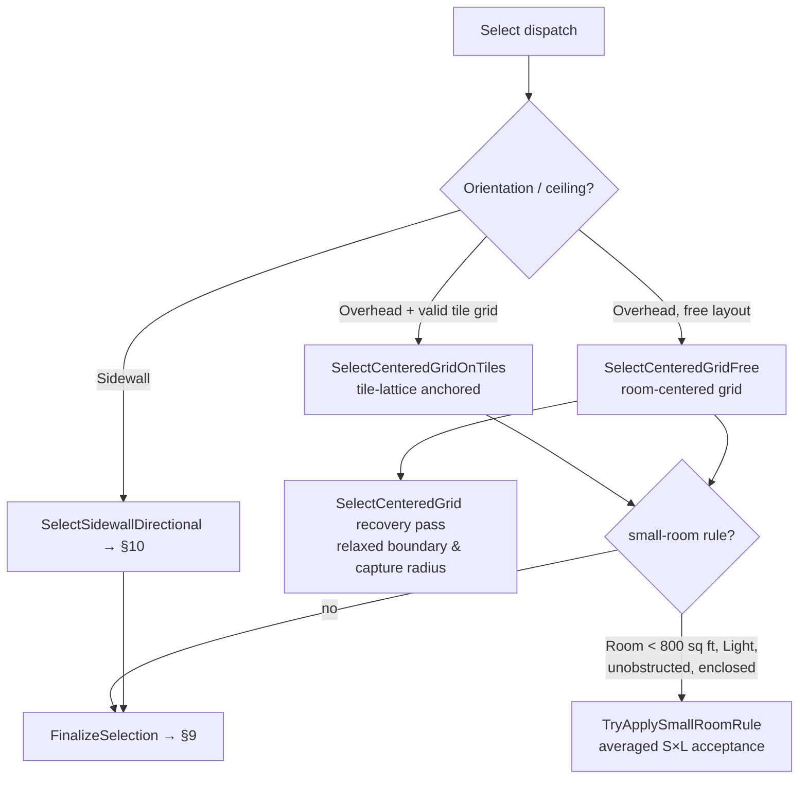
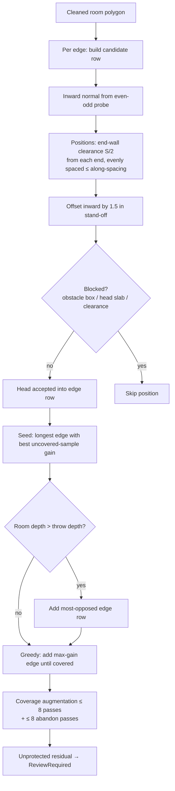
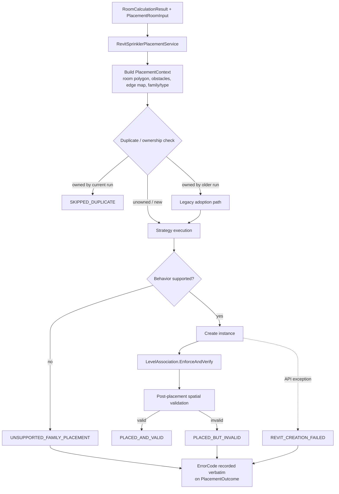

# Fire Protection — Sprinkler Layout & Placement

**System overview, calculation workflow, and placement logic**

| | |
|---|---|
| **Document** | `FireProtection-Sprinklers.md` |
| **Scope** | Sprinkler point calculation and family placement in the FireProtectionSystem solution |
| **Status** | Provisional — see [Disclaimer](#disclaimer) |
| **Basis** | Current source code (authoritative). NFPA 13 citations are transcribed from the design-basis rulebook in code. |
| **Audience** | Design managers, reviewers, senior engineers, and clients |

---

## Disclaimer

Every sprinkler layout produced by this system is **provisional and flagged `ReviewRequired`**.

- The design-basis rule set reports `HasApprovedRules = false`. The system never invents a design rule; it applies only values present in the code's rule tables, each traceable to a chapter/page citation of NFPA 13.
- Layout output is a starting point for a licensed fire-protection engineer. It is **not** a sealed design, not a hydraulic calculation, and not a substitute for the AHJ review.
- Hydraulic design, pipe sizing, density/area demand curves, storage commodity classification, ESFR/CMSA design, and obstructions above 18 in. per NFPA 13 Chapter 8 are **out of scope** (see [§13 Constraints](#13-constraints-and-known-gaps)).

---

## Glossary

| Term | Meaning |
|---|---|
| **Deflector** | The plate at the bottom of a sprinkler head that breaks the water stream; its elevation above floor is the *placement Z*. |
| **Placement Z** | World elevation (ft) at which a head's deflector sits. |
| **S / L spacing** | Center-to-center spacing between heads along the room's two layout axes. |
| **Protection area (S×L)** | Area assigned to one head, `max(spacing to nearest neighbors, 2 × distance to wall)` per side, compared against the hazard's maximum coverage area. |
| **Throw depth** | Maximum distance a sidewall head is permitted to project water from the wall (sidewall layouts only). |
| **Hazard class** | Light / Ordinary 1 / Ordinary 2 / Extra Hazard 1 / Extra Hazard 2, derived from the Revit room name. |
| **FamilyPlacementType** | Revit's placement mode for a family: FaceBased, WorkPlaneBased, OneLevelBased, etc. Drives which placement strategy can host the family. |
| **Obstacle box** | Axis-aligned bounding box of an obstruction (beam, duct, column, light, etc.) with a required horizontal clearance. |
| **Rulebook** | The transcribed NFPA 13 constants in code (`Nfpa13RulebookRules`), each carrying chapter/page provenance. |

---

## 1. System Overview

The sprinkler workflow is split into three strictly separated layers. Only the outermost layers touch the Revit API; the calculation core is pure .NET and testable without Revit.

```mermaid
flowchart LR
    subgraph L1["Layer 1 — Extraction (read-only, Revit API)"]
        A1[FireProtectionExtractionService] --> A2[Levels / Rooms / Ceilings]
        A1 --> A3[Obstacles / Existing sprinklers]
        A2 & A3 --> A4[ModelExtractionValidator]
        A4 --> A5[JSON snapshot<br/>+ PlacementInputSnapshot]
    end

    subgraph L2["Layer 2 — Calculation (Revit-free)"]
        B1[BruteForceCalculationService.CalculateRoom] --> B2[Hazard + rule merge]
        B2 --> B3[Ceiling selection &amp; Z resolution]
        B3 --> B4[Candidate generation<br/>centered grid / tile grid / sidewall]
        B4 --> B5[Validity &amp; coverage checks]
        B5 --> B6[FinalizeSelection<br/>RoomCalculationResult]
    end

    subgraph L3["Layer 3 — Placement (Revit API)"]
        C1[RevitSprinklerPlacementService] --> C2[PlacementStrategyResolver]
        C2 --> C3{FamilyPlacementType}
        C3 -->|FaceBased| C4[FaceBasedPlacementStrategy<br/>ceiling host via CeilingHostResolver]
        C3 -->|WorkPlaneBased| C5[WorkPlaneBasedPlacementStrategy]
        C3 -->|LevelBased| C6[LevelBasedPlacementStrategy]
        C3 -->|Wall / sidewall| C7[WallSidewallPlacementStrategy]
        C4 & C5 & C6 & C7 --> C8[LevelAssociation.EnforceAndVerify]
        C8 --> C9[Post-placement validation<br/>→ PlacementOutcome]
    end

    A5 --> B1
    B6 --> C1
```



**Layer responsibilities**

| Layer | Project | Rule |
|---|---|---|
| Extraction | `FireProtection.Backend` (Extraction) | Read-only. Normalizes all linked-model geometry into host-MEP coordinates during extraction. |
| Calculation | `FireProtection.Backend` (`BruteForce`) | Revit-free. Produces `RoomCalculationResult` with candidate points, warnings, and diagnostics. |
| Placement | `FireProtection.Backend` (Placement + Strategies) | Revit-API-aware at the edges only. Applies **one coordinate system already normalized in extraction** — placement never applies a second transform. |

> **Dependency rule:** `FireProtection.Backend` references `FireProtection.UI` one-way (for shared result models). The UI never references the Backend.

---

## 2. Design Basis and Standards

### 2.1 Provenance

| Item | Value |
|---|---|
| Design basis | NFPA 13 as transcribed into `Nfpa13RulebookRules` (design-reference: NFSA textbook *Layout, Detail and Calculation of Fire Sprinkler Systems*, NFPA 13 2002 edition) |
| Snapshot metadata label | `Standard = "NFPA13-2022"` (extraction header) |
| Approved rules | **None** — `DefaultHazardPlacementRules.HasApprovedRules => false` |
| Every rule value | Carries a chapter/page citation in code (e.g. `NFPA13-2002, Ch.19 p.222`) |

The two labels above (2002 design reference vs. 2022 snapshot metadata) coexist in the codebase; the **numeric values in the rule tables trace to the 2002 citations**. Reviewers should confirm the governing edition for any project before relying on a layout.

### 2.2 Hazard placement rules

Merged per room: hazard class defaults → ceiling-construction adjustments → per-room overrides. Nothing outside these sources can change a limit.

| Hazard | Max spacing (ft) | Min spacing (ft) | Max area/head (sq ft) | Coverage radius (ft) | Orientation factor | K-factor (info only) |
|---|---|---|---|---|---|---|
| Light | 15 | 6 | 225 | 7.5 | 1.0 | — |
| Ordinary 1 | 15 | 6 | 130 | 7.5 | 0.90 | — |
| Ordinary 2 | 15 | 6 | 130 | 7.5 | 0.85 | 8.0 |
| Extra Hazard 1 | 12 | 6 | 100 | 6.0 | 0.80 | — |
| Extra Hazard 2 | 12 | 6 | 100 | 6.0 | 0.75 | 11.2 |

- **Orientation factor** multiplies max spacing only when `0 < factor < 1`; values ≥ 1 never loosen a limit.
- **K-factors are recorded, not enforced** — the system does not perform hydraulic demand calculations.
- **Spacing is additionally clamped by hazard class** (`ClampToNfpa13MaxSpacing`): 15 ft for Light/OH, 12 ft for EH — applied after any ceiling-height or orientation factor.

**Obstacle horizontal clearances (ft):**

| Hazard | Beam | Column | Duct |
|---|---|---|---|
| Light | 1.0 | 1.0 | 1.5 |
| Ordinary 2 | 1.5 | — | 2.0 |
| Extra Hazard 1 | 2.0 | 1.5 | 2.5 |
| Extra Hazard 2 | 2.5 | 2.0 | 3.0 |

### 2.3 Sidewall rule set (NFPA 13 Table 19-2, Ch. 19 p. 234)

| Hazard | Wall finish | Max along-wall spacing (ft) | Max single-row width (ft) | Max area/head (sq ft) |
|---|---|---|---|---|
| Light | Combustible | 14 | 14 | 120 |
| Light | Noncombustible | 14 | 14 | 196 |
| Ordinary 1 | Combustible | 10 | 10 | 80 |
| Ordinary 1 | Noncombustible | 10 | 10 | 100 |

- **Wall finish defaults to Combustible** (the restrictive column) unless the room's `SidewallWallFinish` starts with `non` — finish is not reliably derivable from the model, so the restrictive limit is used.
- A manufacturer's **listing may tighten but never loosen** any Table 19-2 value (area, along-wall spacing, throw, end-wall clearance).
- Stand-off from wall: **1.5 in** (`SidewallStandOffFromWallFt`).
- End-wall clearance default: **S/2** (Fig. 21-2, Ch. 21 p. 266); overridable per room from the listing.
- Deflector height: **4–6 in below ceiling** (Ch. 19 p. 234); no pendent drop is applied to sidewall heads.

### 2.4 Boundary and structural references

| Rule | Value | Citation |
|---|---|---|
| Min. distance, sprinkler to wall | 4 in | Ch. 19 p. 220 |
| Narrow-room relaxation (min room dimension < 8 ft) | boundary clearance relaxed to `MinWallClearanceFt` (0.333 ft ≈ 4 in) unless an explicit override is set | code policy |
| Three-times rule (limiting obstacle distance) | `min(3 × room dimension, ThreeTimesRuleMaxRequiredDistanceFt)` | Ch. 20 p. 248 |
| Lower-zone fixtures > 4 ft above floor | reported as obstructions | Ch. 20 p. 248 |
| Beam deflector-height table | NFPA 13 Table 8.6.5.1.2 (0 in. under a beam < 1 ft away → 15 in. at ≥ 6 ft) | see §13 note |

---

## 3. Hazard Classification

`HazardClassifier` maps the **Revit room name** to a hazard class via keyword tables (e.g. "office" → Light; "storage/kitchen" → Ordinary; "chemical/paint" → Extra Hazard). Classification is name-driven only — no parameter on the room overrides it.

- Unmatched names fall back to the configured default class (Light) and emit a diagnostic.
- The classified class seeds `HazardPlacementRuleSet`, which then receives ceiling-construction adjustments and per-room overrides (§2.2).

---

## 4. Inputs

### 4.1 Extraction

`FireProtectionExtractionService` composes five extractors plus validation:

| Extractor | Captures |
|---|---|
| LevelExtractor | Levels (elevation basis) |
| RoomExtractor | Room boundary loops, number, name, level |
| CeilingExtractor | Ceiling/floor/roof planes per room (bottom elevation, slope) |
| ObstacleExtractor | Beams, columns, ducts, lights, equipment — keyed by configurable `obstacleCategoryKeys` |
| ExistingSprinklerExtractor | Already-placed sprinkler XY positions |

**Snapshot conventions:** units `ft` / `sq_ft` / `cu_ft` / `degrees`; coordinate system `host_mep_model`. All linked-model geometry is transformed to host coordinates **here**, once.

### 4.2 Validation

`ModelExtractionValidator` produces a `ValidationSummary` covering: element counts, unloaded links, duplicate room IDs, room boundaries with < 3 vertices, rooms without ceilings, and links containing no geometry. Validation failures are surfaced, never silently patched.

### 4.3 Room association

- Obstacle → room: XY containment **and** Z overlap with the room.
- Sprinkler → room: point-in-room XY test (device ownership stamps, §12.4, add a second line of evidence).

### 4.4 Input assembly and per-room overrides

`PlacementInputBuilder` converts the snapshot into `PlacementRoomInput` per room. Available overrides:

| Group | Fields |
|---|---|
| Family selection | Sprinkler family name, type name, orientation (pendent / sidewall / auto) |
| Spacing | `OverrideMaxSpacingFt`, `OverrideMinSpacingFt`, `OverrideBoundaryClearanceFt` |
| Sidewall | `SidewallWallFinish`, listed max throw, listed end-wall clearance, listed along-wall spacing |
| Ceiling / tile | `OverrideTileSizeFt`, ceiling-related overrides |
| Type catalog | `TypeMaxCoverageAreaSqFt`, `TypeSidewallMaxAlongWallSpacingFt`, `TypeSidewallMaxThrowFt`, `TypeSidewallEndWallClearanceFt` |

**Orientation cascade** (first match wins): explicit room value → family `WallSidewall` behavior → `CeilingOverhead` → pendent → mount string → family-name keyword. `"(auto)"` counts as unspecified; sidewall forces the `WallSidewall` placement behavior.

`PlacementInputJsonExporter` (Newtonsoft, indented) exports the full input — global obstacles and existing sprinklers filtered by enabled categories (Catalog settings) — to `Documents\FireProtectionSystem\Exports`, enabling the Revit-free calculation path to be reproduced from a file.

---

## 5. Geometry Model

- Room boundaries are stored as an outer loop plus inner loops (columns, shafts). Signed area determines winding; `MergeCollinearVertices` and `MergeLoop` reduce the loops to a **single cleaned polygon** that is shared by candidate generation, coverage checks, and placement. One loop means one meaning for every downstream index.
- `PointInPolygon` (in `GeometryMath`) uses an even-odd ray cast with tolerance-based edge proximity — no exact float equality anywhere.
- `RoomGeometry` owns the cleaned loops, bounding box, area, and `IsPointInsideRoom(x, y, tol)`.

---

## 6. Ceiling Selection and Z Resolution

### 6.1 Primary ceiling

`SelectPrimaryCeiling` ranks candidate ceiling planes per room:

1. Same level as the room (rank 0), else elevation match
2. Flat preferred over sloped
3. Smallest `|BottomElevationFt − expectedCeilingZ|`

If the selected plane is not the nominal ceiling, a diagnostic is emitted so the choice is auditable.

### 6.2 Construction class

`CeilingConstructionClass` from NFPA 13 obstructed/obstructed-classifier rules, evaluated against the ceiling's structure:

| Class | Criterion |
|---|---|
| Unobstructed | no structure / clear span |
| Unobstructed, spaced members | member spacing > 7.5 ft o.c. |
| Obstructed | 3–7.5 ft o.c. |
| Obstructed, dense members | ≤ 3 ft o.c. |

Beam data available as AABBs alone cannot prove the 70 % open-cross-section test, so anything with structure between 3–7.5 ft is classified conservatively as obstructed.

### 6.3 Placement Z

```
ceilingZ = ceiling bottom  (sloped ceiling → averaged plane elevation)
         → else room height fallback if ≥ 7.5 ft
         → else 9 ft default
deflectorZ = ceilingZ − drop
drop = 1–12 in (pendent/upright, unobstructed)
     = 1–6 in  (obstructed ceiling)
3 ft peak-clearance rule applies above the drop band
```

Sidewall heads: deflector 4–6 in below ceiling (§2.3) — a room-uniform Z computed once, not per head.

---

## 7. Candidate Point Identification

Two ceiling layouts and one wall layout, dispatched by orientation:



### 7.1 Grid resolution

`ComputeGridResolution` starts at `min(config.GridResolutionFt, CoverageRadiusFt)` and **doubles until the estimated candidate count fits `MaxCandidatePoints`** (guards: 64 iterations, 25 ft / 4× coverage-radius caps). Narrow rooms (< 8 ft) are allowed 1.0 ft stepping; floor of the search is `CoverageRadiusFt / 2`.

### 7.2 Candidate acceptance

Every candidate is tested by `IsPlacementValid` before it can be selected:

| Check | Rule |
|---|---|
| Inside room | even-odd test with tolerance |
| Wall clearance | ≥ effective boundary clearance (§2.4) |
| Obstacle clearance | XY distance to each obstacle box ≥ its hazard clearance, when the box spans the placement Z |
| Three-times rule | distance to a limiting obstacle ≥ `min(3 × dim, cap)`, with the opposite-side-of-sprinkler exception |
| Beam table | NFPA 13 Table 8.6.5.1.2 deflector height vs. horizontal distance to beam edge, applied to framing and duct candidates |
| Existing heads | candidate must not duplicate an existing sprinkler position |

**Search budget:** candidate enumeration and spacing recovery are bounded by `MaxSearchIterations` (500 000). Budget exhaustion is reported, not retried indefinitely.

### 7.3 Config defaults (`BruteForceCalculationConfig`)

| Parameter | Default | Meaning |
|---|---|---|
| `ToleranceFt` | 1 × 10⁻⁶ | geometric tolerance |
| `GridResolutionFt` | 1.0 | starting step |
| `MaxCandidatePoints` | 4000 | candidate cap per room |
| `MaxSearchIterations` | 500000 | search budget |

---

## 8. Mathematical Methods

All of the following run in the Revit-free layer and are exercised by the console test harness.

| Method | Location | Math |
|---|---|---|
| Point-in-polygon | `GeometryMath.PointInPolygon` | even-odd ray cast; edge proximity handled by tolerance |
| Signed area / winding | `RoomGeometry` | shoelace formula; determines inward normal direction |
| Tile lattice | `CeilingGridMath.CeilingGrid` | origin + U/V unit vectors + rotation; factories `FromReadable`, `FromTileSize`, `CreateAlignedGrid`; validity flag carried with origin source |
| Balanced tile layout | `TileCentricPatternGenerator` | solves the **X–2X–X** whole-tile-pitch pattern (center tile flanked by half tiles) along each axis; counts usable blocks, solves each axis, snaps candidate positions to tile centers |
| Protection area per head | `CoverageAreaMath` | `S × L` rule isolated from Revit: S/L = max(nearest-neighbour spacing, 2 × wall distance); small-room path uses averaged S×L |
| Required head count | `FinalizeSelection` | `ceil(room area / MaxCoverageAreaSqFt)` — advisory count, not a layout |
| Coverage sampling | coverage samplers | fixed (non-jittered) grid over the room, step ≥ 0.25 ft and ≤ 1.0 ft (sidewall) or `max(min(radius, S)/3, 0.5)` ft (ceiling); capped at 12 000 samples so reporting stays affordable on large rooms |
| Coverage radius | `FinalizeSelection` | effective radius `S/√2` (diagonal reach), remote-point limit `0.7·S` |

**Determinism:** the sampling grid is fixed — no random jitter — so the same inputs always produce the same layout and the same coverage report.

---

## 9. Feasible Layout Selection (Ceiling)

### 9.1 Centered grid

`SelectCenteredGrid` computes target counts `nx = ceil(width / spacing)` per axis (one column/row for narrow rooms), places cell-center targets from the room centroid, then resolves each target:

1. **Exact** — if the target point is valid, take it.
2. **Snap within capture radius** — nearest valid point inside the radius.
3. **Expanded snap** — up to S/2.
4. **Nearest valid anywhere** — bounded fallback.

Minimum-spacing against already-chosen heads is enforced during resolution. If too many targets are skipped, a **recovery pass** (capped at `max(cellsSkipped + 4, 6)`) fills the largest gaps with valid candidates.

### 9.2 Tile-anchored grid

When the selected ceiling yields a valid tile grid, `SelectCenteredGridOnTiles` places candidates on tile centers of the X–2X–X pattern instead of the free grid, keeping heads aligned with the ceiling tile module. The same acceptance checks apply.

### 9.3 Finalize (all layouts)

`FinalizeSelection` runs, in order:

1. **Max-spacing check** — per head, nearest-neighbour distance only (all-pairs comparison would false-flag diagonal neighbours in a rectangular layout).
2. **Min-spacing check** — reports bunched heads (advisory; does not delete).
3. **Wall-clearance re-check**.
4. **S×L protection-area check per head** against the hazard maximum (or averaged acceptance for small rooms).
5. **Coverage sampling** — records `CoverageSampleCount` / `CoverageUncoveredSampleCount`; 0/0 means *not measured*.
6. **Required-count comparison** — `ceil(area / MaxCoverageAreaSqFt)` vs. placed count.
7. **Provisional flag** — because `HasApprovedRules = false`, the result status is promoted to `ReviewRequired`.

---

## 10. Sidewall Solver

`SelectSidewallDirectional` implements a wall-row layout governed entirely by Table 19-2 (§2.3).



**Key derived values** (all from the rulebook or the type listing, never invented):

- `alongSpacing` = Table 19-2 spacing, tightened (only) by a listed value.
- `throwDepth` = `min(maxArea ÷ alongSpacing, singleRowWidth)`, then tightened (only) by a listed throw. A diagnostic records whether the area limit or the width limit governed.
- `endWallMax` = listed value, else `S/2`.
- Sidewall feasibility: if the room's minimum dimension exceeds the maximum room width a single row may serve, the result carries a `ReviewRequired` diagnostic.
- Opposing rows are added only when measured room depth exceeds `throwDepth`.
- **Coverage augmentation**: up to 8 head-adding passes and 8 abandon passes; each pass targets the *worst* uncovered floor sample and probes legal positions *between* existing heads on every wall (so minimum spacing is respected). Samples given up on are tracked separately and are **not** reported as covered. Added heads are reported in diagnostics.
- Sidewall obstruction testing includes a **head-slab overlap test**: a wall-mounted obstruction shallower than the stand-off reach would be missed by a centre-point test alone.

---

## 11. Family and Host Identification

### 11.1 Behavior resolution

`DevicePlacementBehaviorResolver` maps the family's Revit metadata to a placement behavior:

| FamilyPlacementType | Behavior |
|---|---|
| FaceBased | FaceHosted |
| WorkPlaneBased | WorkPlaneDependent |
| OneLevelBased | LevelHosted |

Mount refinement then maps `WallSidewall` and `CeilingOverhead` mounts onto the behavior; a sidewall mount forces the wall strategy. **Unsupported combinations are hard-blocked** — the resolver never silently substitutes a different hosting method.

`RevitSprinklerFamilySource` supplies the `DevicePlacementContext` (family, type, placement type, behavior, resolved flag, failure reason) for each family/type being placed.

### 11.2 Strategy selection

| Strategy | Hosting | Notes |
|---|---|---|
| **FaceBasedPlacementStrategy** | Ceiling face via `CeilingHostResolver` | Attaches to the ceiling's bottom face; optional open-structure fallback places on a sketch-plane workplane (`WorkPlaneOpenDeck`) |
| **WorkPlaneBasedPlacementStrategy** | Face first, else work plane | Pins `INSTANCE_FREE_HOST_OFFSET_PARAM` to hold the Z |
| **LevelBasedPlacementStrategy** | Level | `NewFamilyInstance(point, symbol, level, StructuralType.NonStructural)` |
| **WallSidewallPlacementStrategy** | Wall / face / workplane / level family modes | Handles all four family modes; positions heads at the solver's stand-off points |

**`CeilingHostResolver`** caches ceilings, floors, and roofs (host **and** linked models) for the whole placement pass, and reports the nearest valid host above the target Z. **`CeilingFaceSelector`** (Revit-free) picks the lowest downward-facing planar face across *all* candidate elements — correct for rooms with multiple stacked ceilings.

### 11.3 Level association

`LevelAssociation.EnforceAndVerify(doc, instance, level, targetWorldZ)` after every placement:

1. Set `INSTANCE_SCHEDULE_ONLY_LEVEL_PARAM` and `INSTANCE_REFERENCE_LEVEL_PARAM`.
2. Set the family's level parameter where present.
3. Set the instance's host-offset so the deflector lands at `targetWorldZ` (`offset = targetWorldZ − level.Elevation`).
4. Re-read the parameters; a mismatch is a placement failure, not a warning.

---

## 12. Placement Execution

### 12.1 Service flow



### 12.2 Outcome contract

A created Revit instance **does not by itself mean success**. Every placement resolves to a `PlacementOutcome` carrying one of the status codes below; failures carry a structured `ErrorCode` recorded verbatim for diagnostics and reporting.

### 12.3 Status and error codes

| Placement status | Meaning |
|---|---|
| `PLACED_AND_VALID` | Instance created, level verified, spatially valid |
| `PLACED_BUT_INVALID` | Instance exists but failed post-placement validation |
| `PLACEMENT_FAILED` | No instance created |
| `SKIPPED_DUPLICATE` | Same device already present |
| `SKIPPED_ROOM_HAS_DEVICES` | Room already served by owned devices |

| Error code | Trigger |
|---|---|
| `NON_FINITE_COORDINATES` | NaN/Inf in target point |
| `LEVEL_RESOLUTION_FAILED` | No usable level for the target Z |
| `UNSUPPORTED_FAMILY_PLACEMENT` | Family placement type not handled by any strategy |
| `REQUIRED_HOST_UNAVAILABLE` | Ceiling/wall host not found |
| `WORKPLANE_UNAVAILABLE` | No work plane at target Z |
| `INVALID_HOST` | Host element rejected |
| `REVIT_CREATION_FAILED` | Revit API threw during creation |
| `POST_PLACEMENT_VALIDATION_FAILED` | Level/offset/geometry verification failed |
| `DUPLICATE` | Duplicate device |

**Calculation statuses** (produced in Layer 2):

| Status | Meaning |
|---|---|
| `Success` (0) | Valid layout, no advisories |
| `ReviewRequired` (1) | Provisional by default; also triggered by feasibility advisories (sidewall width, ESFR/CMSA hazard, etc.) |
| `InvalidInput` (2) | Malformed room/override input |
| `InvalidRoomGeometry` (3) | Degenerate polygon (< 3 vertices after cleaning) |
| `MissingCeiling` (4) | No ceiling plane for the room |
| `UnsupportedCeiling` (5) | Ceiling structure unsupported for the chosen layout |
| `NoValidCandidates` (6) | Every candidate rejected by acceptance checks |
| `InsufficientCoverage` (7) | Coverage sampling found unprotected floor |
| `Failed` (8) | Unhandled failure with diagnostics |

### 12.4 Device ownership

`DeviceOwnershipStamp` writes a marker into the family's **Comments** parameter so re-runs are idempotent:

- `DeviceOwnershipInfo`: `IsOwned`, `IsCurrent`, `IsLegacy`, `RoomKey`, `RunStamp`.
- `RoomKey` = room number + link instance name (room IDs collide across linked models).
- Legacy stamps lack `RoomKey`; adoption falls back to geometry matching.

`FamilyLoadHelper.Load(document, familyFilePath)` loads a family with a before/after snapshot of the loaded family set (the `LoadFamily` boolean return is unreliable) and **must be called with no transaction open**.

---

## 13. Constraints and Known Gaps

| # | Constraint | Classification |
|---|---|---|
| 1 | All output is provisional (`HasApprovedRules = false`); values trace to NFPA 13 (2002) citations while snapshot metadata labels NFPA13-2022 | **Implemented, provisional** |
| 2 | Hydraulic demand, pipe sizing, density/area curves, K-factor enforcement | **Out of scope** |
| 3 | Storage commodity classification; ESFR/CMSA/ESFR-on-storage design — hazards matching these patterns emit a `ReviewRequired` advisory with a generic density/area note (0.30/0.40 gpm/ft² over 2500 ft²), not a design | **Out of scope (advisory only)** |
| 4 | Obstructions more than 18 in. above the deflecting level (NFPA 13 Ch. 8 detail) | **Out of scope** |
| 5 | Beam deflector-height table (Table 8.6.5.1.2) is implemented and applied in the calculation service, while the rulebook's gap list records it as *not reproduced* in the transcribed rulebook | **Discrepancy — review before relying on beam-Z checks** |
| 6 | Sloped ceilings: heads sit at the averaged plane elevation rather than the true slope at each XY | **Simplification — conservative? unverified** |
| 7 | Ceiling open-cross-section (70 %) test cannot be evaluated from AABB beam data; structure between 3–7.5 ft o.c. is classified conservatively as obstructed | **Conservative simplification** |
| 8 | Hazard classification is room-name keyword based; no parameter override | **Implemented limitation** |
| 9 | Sidewall layouts cover only the wall-row rules of Table 19-2; room width beyond single-row/opposing-row capability raises `ReviewRequired` rather than switching to extended-coverage design | **Implemented, conservative** |
| 10 | Small-room averaging (< 800 sq ft) relaxes the per-head S×L test to an averaged acceptance | **Implemented policy** |
| 11 | Coverage reporting is sampled, not exhaustive; step is bounded (≥ 0.25 ft, ≤ 1.0 ft) with a 12 000-sample cap on very large rooms | **Implemented; sampling caps may under-report tiny gaps in very large rooms** |
| 12 | Second coordinate transform must never be applied at placement — geometry is normalized during extraction | **Architectural invariant** |

---

## 14. Verification Status

Two kinds of verification are kept strictly apart:

### 14.1 Static (provable by reading code)

- Layer separation: extraction → calculation → placement; UI never references Backend.
- Rule values, citations, and clamp logic in `Nfpa13RulebookRules` / `DefaultHazardPlacementRules`.
- Candidate acceptance checks, spacing clamps, coverage sampling, and status codes.
- Strategy dispatch, level association, ownership stamping, outcome contract.
- Coordinate normalization performed only in extraction.

### 14.2 Runtime (requires Revit — **not verified by this document**)

- Placing a family of each placement type into a live model with real families.
- Face attachment to actual ceilings/floors/roofs, including linked models.
- Sidewall wall hosting and stand-off positions against real wall geometry.
- Post-placement level/offset read-back on sloped ceilings.
- End-to-end idempotent re-run (duplicate detection and legacy adoption).
- Extraction from a linked-model project and snapshot round-trip.

Compilation and static review do **not** imply runtime correctness. Every item in §14.2 must be exercised in an open Revit model with the project's families and links before any layout is trusted.

---

## Appendix A — Constants Reference

| Constant | Value | Where |
|---|---|---|
| `ToleranceFt` | 1 × 10⁻⁶ | `BruteForceCalculationConfig` |
| `GridResolutionFt` (default) | 1.0 ft | `BruteForceCalculationConfig` |
| `MaxCandidatePoints` | 4000 | `BruteForceCalculationConfig` |
| `MaxSearchIterations` | 500 000 | `BruteForceCalculationConfig` |
| `MaxCoverageAugmentationPasses` | 8 (+8 abandon passes) | `BruteForceCalculationService` |
| `SidewallHeadHalfLengthFt` | 0.25 ft (≈ 6 in head body) | `BruteForceCalculationService` |
| Sidewall stand-off | 1.5 in | `Nfpa13RulebookRules.SidewallStandOffFromWallFt` |
| Sidewall end-wall default | S/2 | Fig. 21-2, Ch. 21 p. 266 |
| Min wall distance | 4 in | Ch. 19 p. 220 |
| Narrow-room boundary relaxation | < 8 ft min dimension → 0.333 ft | code policy |
| Three-times rule | `min(3 × dim, cap)` | Ch. 20 p. 248 |
| Small-room rule | < 800 sq ft, Light, unobstructed, enclosed (8 in lintel) | code policy |
| Effective coverage radius | `S/√2`; remote limit `0.7·S` | `FinalizeSelection` |
| Coverage sample cap | 12 000 (sidewall) | `SelectSidewallDirectional` |
| Beam table | Table 8.6.5.1.2: 0 in (< 1 ft) → 15 in (≥ 6 ft) | `Nfpa13BeamRuleTable` |
| Default hazard factor (Light) | 1.0; OH1 0.90, OH2 0.85, EH1 0.80, EH2 0.75 | `DefaultHazardPlacementRules` |

---

## Appendix B — Status and Error Codes

See [§12.3](#123-status-and-error-codes) for the full placement status codes, calculation error codes, and calculation status enum. Definitions live in:

- `PlacementStrategyContracts.cs` → `PlacementStatusCodes`
- `CalculationStatus.cs` → calculation status enum (numeric values 0–8)

---

## Appendix C — Parameters and Overrides

See [§4.4](#44-input-assembly-and-per-room-overrides) for the per-room override set and orientation cascade, and [§7.3](#73-config-defaults-bruteforcecalculationconfig) for engine configuration defaults.

---

## Appendix D — Source Map

| Concern | File (under `FireProtection.Backend` unless noted) | Role |
|---|---|---|
| Engine | `Services\Placement\Sprinklers\Final\BruteForce\BruteForceCalculationService.cs` | Room calculation, dispatch, grids, finalize |
| Rulebook | `...\BruteForce\Nfpa13RulebookRules.cs` | NFPA 13 constants with chapter/page provenance |
| Hazard rules | `...\BruteForce\DefaultHazardPlacementRules.cs`, `HazardPlacementRuleSet.cs` | Per-hazard spacing/area rules and merge logic |
| S×L math | `...\BruteForce\CoverageAreaMath.cs` | Revit-free protection-area rule |
| Geometry | `...\BruteForce\RoomGeometry.cs`, `GeometryMath.cs` | Polygon cleaning, even-odd point-in-polygon |
| Config | `...\BruteForce\BruteForceCalculationConfig.cs` | Engine defaults |
| Tile grid | `...\BruteForce\CeilingGridMath.cs`, `TileCentricPatternGenerator.cs` | Tile lattice and X–2X–X layout |
| Beam table | `...\BruteForce\Nfpa13BeamRuleTable.cs` | Table 8.6.5.1.2 deflector heights |
| Hazard class | `Models\Hazard\HazardClassifier.cs` | Room-name → hazard class |
| Input assembly | `...\Sprinklers\Final\PlacementInputBuilder.cs`, `PlacementInputJsonExporter.cs` | Snapshot → per-room inputs; JSON export |
| Placement service | `...\Final\RevitSprinklerPlacementService.cs` | Orchestration, outcomes |
| Strategies | `...\Final\Strategies\*.cs` | FaceBased / LevelBased / WorkPlaneBased / WallSidewall |
| Host resolution | `Strategies\CeilingHostResolver.cs`, `CeilingFaceSelector.cs` | Ceiling/floor/roof host caching; face selection |
| Level association | `Strategies\LevelAssociation.cs` | Level params + offset verification |
| Behavior | `Services\Placement\DevicePlacementBehaviorResolver.cs` | FamilyPlacementType → behavior |
| Ownership | `Services\Placement\DeviceOwnershipStamp.cs` | Idempotent re-run marking |
| Family load | `Services\Placement\FamilyLoadHelper.cs` | Snapshot-based family loading |
| Family source | `Services\Placement\RevitSprinklerFamilySource.cs` | DevicePlacementContext |
| Extraction | `Services\Extraction\FireProtectionExtractionService.cs` | Composes extractors |
| Validation | `Services\Extraction\ModelExtractionValidator.cs` | Snapshot validation summary |
| Result models | `FireProtection.UI\Models\Sprinklers\BruteForce\*.cs` | `CalculationStatus`, `RoomCalculationResult`, `CalculatedSprinklerPoint` |
| Input model | `Models\Placement\Sprinklers\Final\PlacementRoomInput.cs`, `PlacementInputSnapshot.cs` | Per-room input contract |

---

## Appendix E — Revision History

| Date | Change |
|---|---|
| 2026-10-23 | Initial issue — document generated from source-code review; static verification only (§14). |
